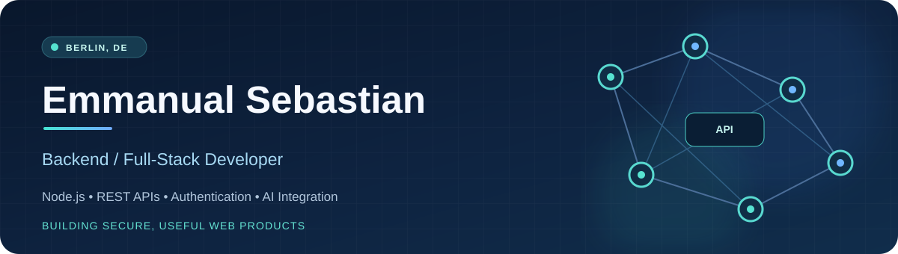

  

Computer Science Graduate · Berlin, Germany · Builder of Aenora

👋 About me
I'm a backend-focused developer and BSc Computer Science and Digitisation graduate from Berlin School of Business and Innovation (BSBI).

I enjoy designing the parts of software that make products work: REST APIs, authentication, authorization, database models, and real-world workflows. My main independent project is Aenora, a functional MVP that helps connect students, vocational schools, and employers in the German Ausbildung process.

I primarily build with JavaScript / Node.js and the MERN stack, with working knowledge of TypeScript. I'm particularly interested in secure backend systems, AI-assisted applications, and expanding my backend skills.
🚀 Selected projects
Project	What I built	Technologies
Aenora · Flagship project	Multi-role Ausbildung recruitment platform with application tracking, organization partnerships, document workflows, and role-aware features. Functional MVP; development ongoing. Private repository — technical overview available on request.	Node.js, Express, React, MongoDB, JavaScript, TypeScript
Learning Management System	Udemy-style platform with instructor/student dashboards, course and video management, enrollment, learning progress, JWT authentication, and PayPal Sandbox checkout testing.	MERN, JWT, PayPal Sandbox
AI Smart Notes	Experimental backend for uploaded content, AI-assisted information processing, and simpler explanations.	Node.js, Express, MongoDB, AI API integration
Dockerized MERN images	Published separate frontend and backend container images to Docker Hub.	Docker, Docker Hub, MERN

About Aenora: The source repository is private. I can share a project walkthrough, architecture overview, or discuss implementation decisions when requested.

🧰 Technical toolkit
Area	Tools and technologies
Backend	JavaScript, Node.js, Express.js, REST APIs, JWT, role-based authorization
Data	MongoDB, Mongoose, data modeling
Frontend	React, HTML, CSS, Tailwind CSS
DevOps	Git, GitHub, Docker, Docker Hub; introductory GitHub Actions / CI/CD
Additional	TypeScript (working knowledge), Python (basic), AI API integration

🛠️ How I approach projects
- Model the workflow: identify user roles, permissions, application states, and data relationships.
- Build maintainable APIs: separate responsibilities and protect resources with authentication and authorization.
- Ship and iterate: develop usable features, test workflows, fix problems, and improve the MVP.
📫 Get in touch
I'm interested in opportunities to grow as a backend / full-stack engineer and contribute to thoughtful, reliable software.

Email: emmanualseba28@gmail.com · Location: Berlin, Germany

Built with curiosity, care, and a focus on practical software.
# emmanual28.
